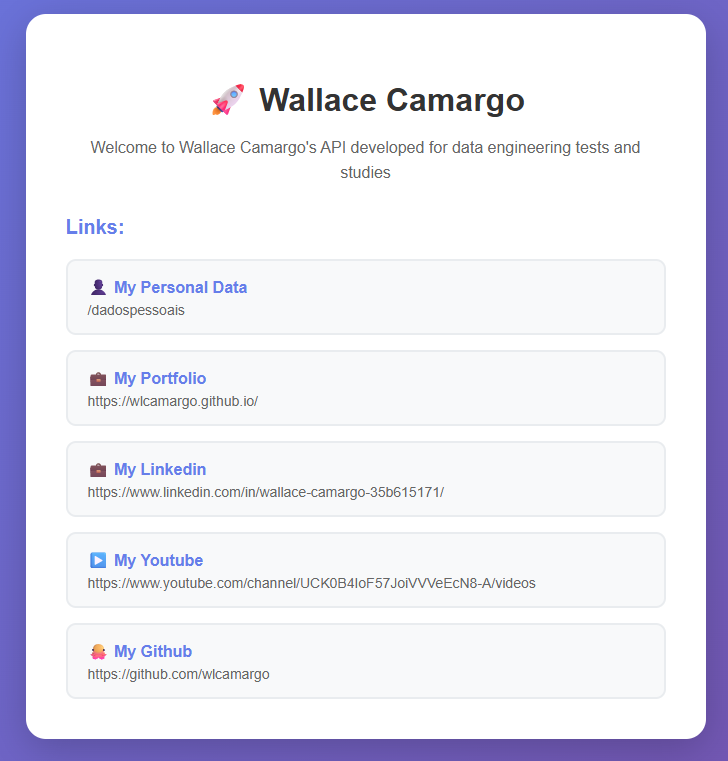
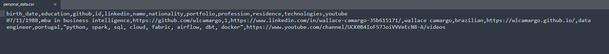

# Api Replit

A finalidade desta api é apenas para teste.


Api desenvolvida em Python e hospedada no site Replit. 

## Link da api
https://e5e2f3a3-454c-43de-b139-659366de071e-00-t572qw8e44wh.janeway.replit.dev/

## Layout da página


## Link do Replit
https://replit.com/


## Como extrair dado da API?
Execute o script python ```get_data_from_api.py```

## Resultado esperado


## 🧑🏼‍🚀 Developer
| Developer    | LinkedIn                                   | Email                        | Portfolio                              |
|--------------------|--------------------------------------------|------------------------------|----------------------------------------|
| Wallace Camargo    | [LinkedIn](https://www.linkedin.com/in/wallace-camargo-35b615171/) | wallacecpdg@gmail.com        | [Portfólio](https://wlcamargo.github.io/)   |